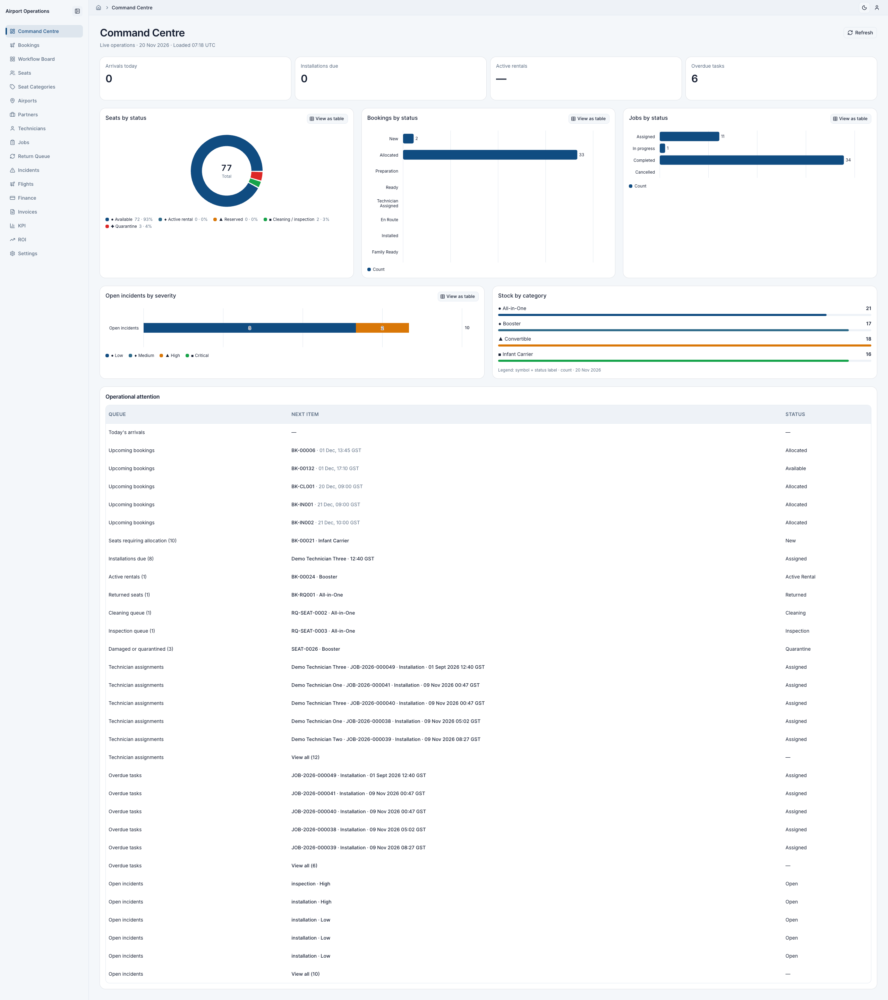
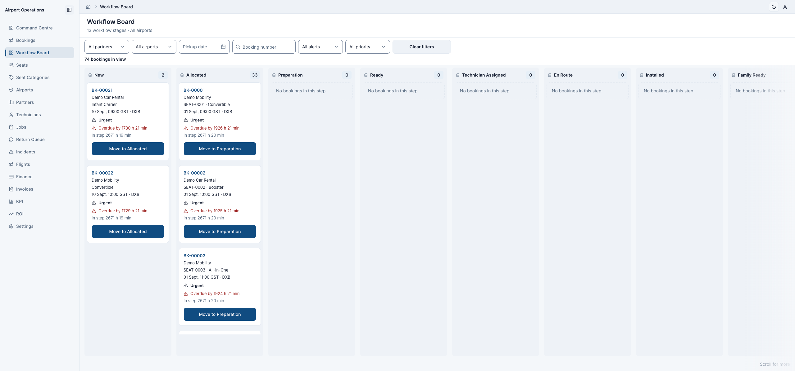
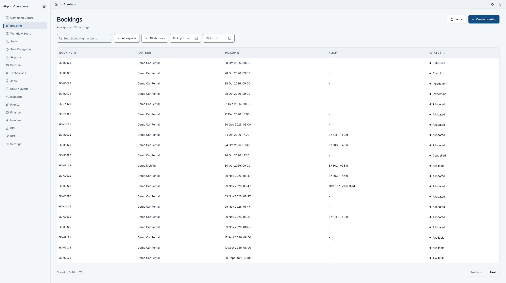
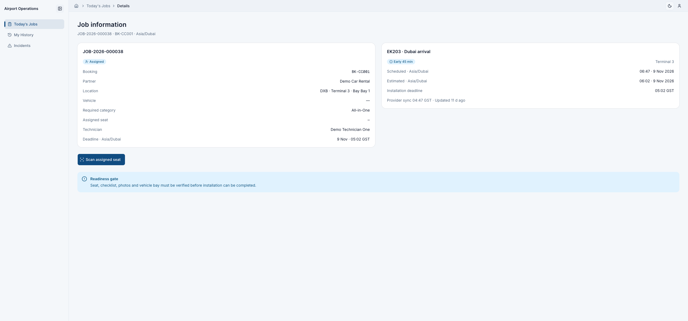
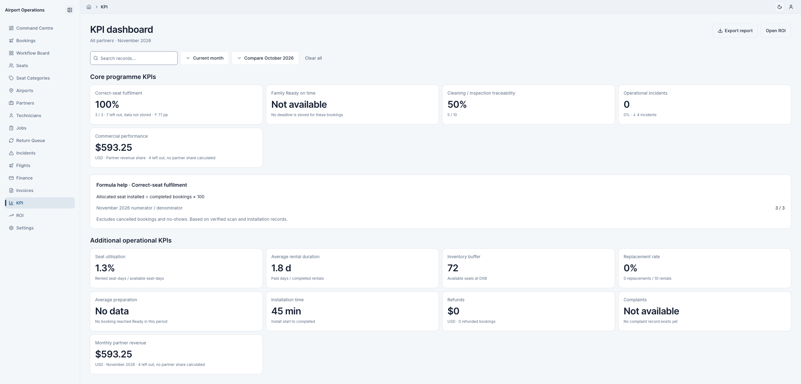
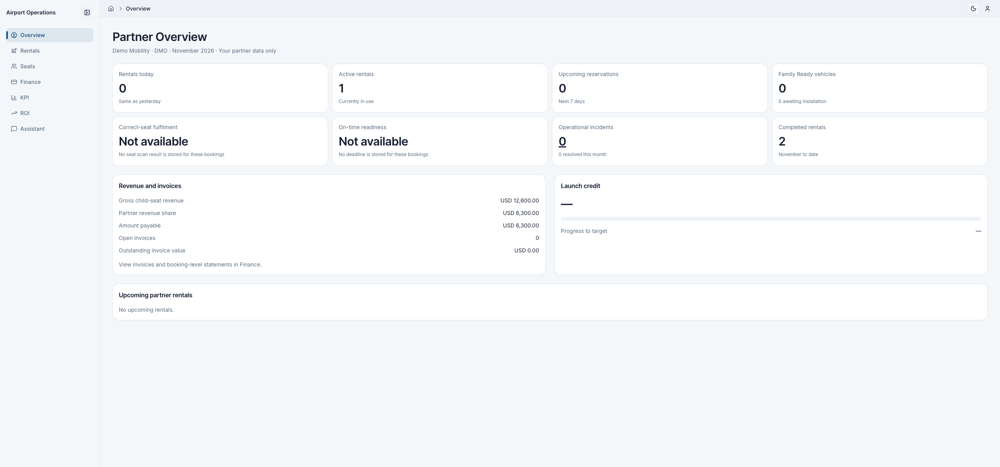
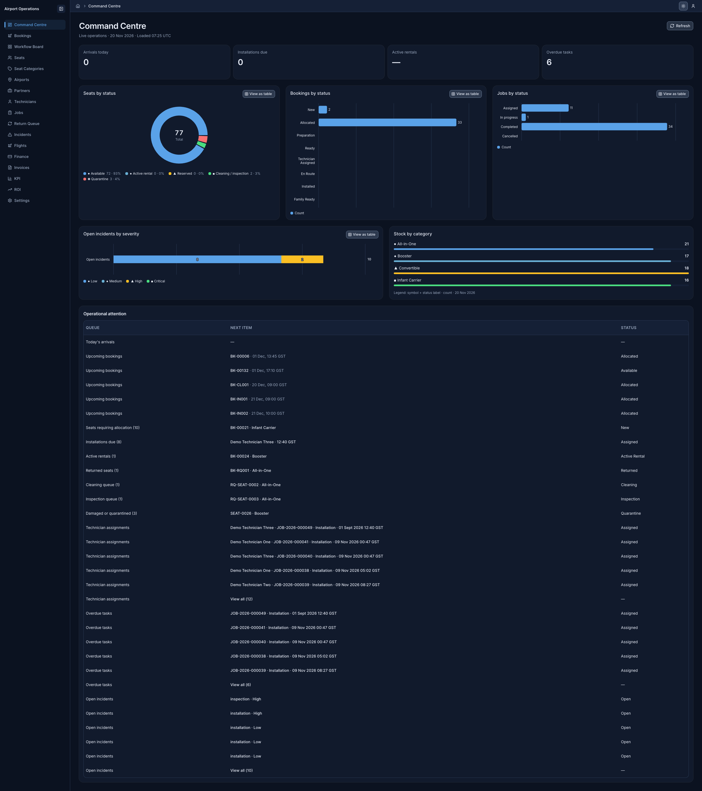

# Airport Operations SaaS

A multi-tenant airport operations SaaS for managing child-seat rental
operations at airports. Rental-car partners, airports, seat inventory and
bookings are managed in one place, with tenant isolation enforced by the
database.

**Live:** [airport-operations-saas.vercel.app](https://airport-operations-saas.vercel.app)

## Demo accounts

Sign in with any of these accounts. They share one public demo password,
`DemoPassw0rd!`, and hold demo data only. Never put real data in a demo
database.

| Email | Role | Sees |
|-------|------|------|
| `admin@airportops.example` | admin | everything |
| `ops.manager@airportops.example` | operations manager | everything, and runs bookings, jobs and incidents |
| `partner.dcr@airportops.example` | partner user (Demo Car Rental) | only its own bookings, seats and incidents |
| `partner.dmo@airportops.example` | partner user (Demo Mobility) | only its own bookings, seats and incidents |
| `technician1@airportops.example` | technician | only its own jobs (also `technician2`, `technician3`) |

On a local database, `npm run demo:reset` loads the same accounts (see
[Database](docs/database.md), "Demo data").

## Main features

- Bookings, with CSV import and a webhook for an external system
- Jobs for technicians: installation, cleaning, inspection, photos and QR scan
- Seat inventory and seat categories, with a QR code for each seat
- Airports, rental-car partners and flight tracking
- Workflow Board and Return queue
- Incidents
- Settlements and invoices
- KPI and ROI dashboards, for managers and for each partner

## Screenshots

All screenshots show demo data.

**Command Centre** (admin): live figures, charts and the queues that need attention.



**Workflow Board** (admin): each booking in the column of its workflow step.



**Bookings** (admin): search, filters, CSV import and a paged list.



**Job** (technician): the booking, the flight, the seat scan and the readiness gate.



**KPI dashboard** (admin): core and additional KPIs, with a formula help panel.



**Partner Overview** (partner user): only the data of the partner.



**Dark mode**: the Command Centre in the dark theme.



## Stack

- Next.js (App Router, Server Components by default) and TypeScript
- Tailwind CSS and shadcn/ui
- Supabase (Auth, PostgreSQL) with database-level Row Level Security
- Zod for input validation
- Vitest for tests

## Getting started

### Prerequisites

- Node.js and npm
- Docker (only to run Supabase locally)

### Setup

```bash
npm install
cp .env.example .env.local
```

Fill in `.env.local`. The app checks these variables when the server
starts and stops with a clear configuration error if one is missing or
invalid:

| Variable | Description |
|----------|-------------|
| `NEXT_PUBLIC_SUPABASE_URL` | Supabase project URL (http or https) |
| `NEXT_PUBLIC_SUPABASE_PUBLISHABLE_KEY` | Supabase publishable key |

Optional:

| Variable | Description |
|----------|-------------|
| `NEXT_PUBLIC_GA_MEASUREMENT_ID` | Google Analytics 4 Measurement ID (`G-XXXXXXX`). Leave it empty to turn Google Analytics off |

Server only, needed by the system jobs (never send them to the browser):

| Variable | Description |
|----------|-------------|
| `SUPABASE_SERVICE_ROLE_KEY` | Supabase service-role key. It bypasses RLS, see [Security](docs/security.md) |
| `CRON_SECRET` | Secret that a scheduler sends to start a system job |

Only `NEXT_PUBLIC_*` values are sent to the browser. Never put a secret or
the service-role key behind that prefix.

### Local Supabase

```bash
npx supabase start       # start the local stack (needs Docker)
npx supabase db reset    # apply migrations and supabase/seed.sql
npx supabase stop
```

`npx supabase start` prints the local API URL and keys to use in
`.env.local`. Studio runs at http://127.0.0.1:54323.

### Run the app

```bash
npm run dev
```

Open [http://localhost:3000](http://localhost:3000).

## Scripts

| Command | Purpose |
|---------|---------|
| `npm run dev` | Start the development server |
| `npm run build` | Production build |
| `npm run start` | Run the production build |
| `npm run lint` | ESLint |
| `npm run typecheck` | TypeScript check, no output files |
| `npm run test` | Vitest |
| `npm run demo:reset` | Reset the local database and load the demo data |
| `npm run demo:verify` | Check the demo data that is loaded |
| `npm run demo:determinism` | Load the demo data twice and compare both loads |
| `npm run release:gates` | Release gates (build quality) |
| `npm run perf:measure` | Performance measurements |
| `npm run release:report` | Release readiness report |

Run `npm run lint`, `npm run test` and `npm run build` before opening a
pull request. There is no CI workflow in the repo yet: the `pre-push` hook
runs lint, tests and build, but not the typecheck, so run `npm run typecheck`
yourself. See [Known limitations](docs/known-limitations.md).

## Deploy

The app runs on Vercel, with a Supabase cloud project as the database.

- Set the environment variables above in the Vercel project. `NEXT_PUBLIC_*`
  values are read at build time, so build again after you change one.
- Apply migrations to the linked Supabase project with
  `npx supabase db push --linked`. Run `--dry-run` first to see what it will do.

## Project structure

```text
src/app/          Routes (route groups: (auth), (admin), (dashboard), (partner), (technician))
src/features/     Feature modules: actions, components, hooks, lib, schemas
src/components/   Shared UI (ui/ = shadcn/ui, layout/ = app shell and navigation)
src/lib/          Auth, Supabase clients, config, shared helpers
src/config/       Static app configuration (navigation)
supabase/         Migrations and seed data
docs/             Architecture, database, security and roadmap
```

## Documentation

- [Architecture](docs/architecture.md)
- [Database](docs/database.md)
- [Security](docs/security.md)
- [Roadmap](docs/roadmap.md) (feature list and status)
- [Git hooks](docs/git-hooks.md)
- [Known limitations](docs/known-limitations.md)

## License

MIT. See [LICENSE](LICENSE).

## Claude Code harness

- Rules: `.claude/rules/` (git workflow, security, frontend, backend, testing)
- Git hooks: `.githooks/` (installed by `npm install` via `scripts/setup-git-hooks.sh`, see `docs/git-hooks.md`)
- Worktrees: `make worktree-new feat/<name>`, `make worktree-list`, `make worktree-rm feat/<name>`
- One-time setup: `make setup`
